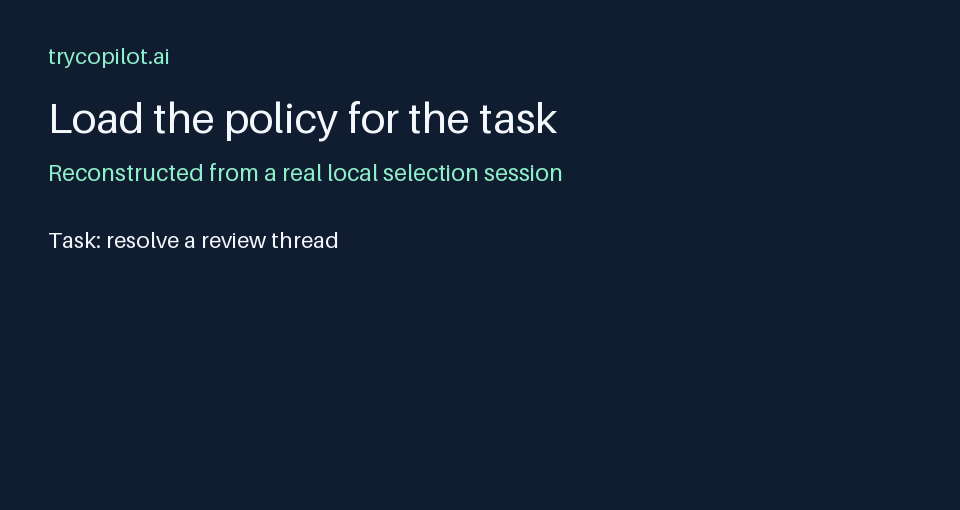

# Agent Standards

Task-scoped operating standards for coding agents, indexed
by the situations they govern.

[](https://github.com/trycopilotai/agent-standards/actions/workflows/auto-lint-pr.yml)
[](https://github.com/trycopilotai/agent-standards/actions/workflows/check.yml)
[](https://github.com/trycopilotai/agent-standards/actions/workflows/lint.yml)

Read a small bootstrap instruction, find the relevant
policy, and load the standards needed for the task. The
collection covers reviews, Git worktrees, provenance,
credentials, remote execution, plans, and sustained task
execution.



[Static demo poster](assets/demo-poster.png) ·
[Exact session transcript](evidence/transcripts/selection.txt)
· [Machine-readable index](standards/index.json)

## Use the standards

Fetch the pinned release into a directory of your choice:

```sh
if [ -d agent-standards/.git ]; then
  git -C agent-standards fetch --depth 1 origin tag v1.0.0
else
  git clone --branch v1.0.0 --depth 1 \
    https://github.com/trycopilotai/agent-standards.git
fi
git -C agent-standards checkout --detach v1.0.0
cd agent-standards
python3 scripts/select_standards.py "resolve a review thread"
```

Run the selector from the checkout; it reads the bundled
index and prints matching files. It uses Python 3.9 or later
and the standard library. Selection is a case-insensitive
substring lookup over declared triggers. Review the results;
it does not infer every policy that could apply.

```sh
python3 scripts/select_standards.py --json "retire a worktree"
python3 scripts/check.py
```

The selector only reads the index. The check reads
repository files and runs local selector cases. Neither
executes the commands described in the standards or contacts
a network.

## Adopt in a repository

Vendor the standards or keep a pinned checkout alongside
your project. Add a short instruction to your AGENTS.md or
the equivalent entrypoint used by your agent:

> Before acting, read the standards index, select the
> entries whose situations match the task, and read their
> files. Follow this repository's explicit instructions when
> they override a reusable default.

Set the index path to the location you chose. This
collection does not install hooks, inject instructions,
change an agent's settings, or enforce its prose policies.
Adapt launchers, storage locations, merge methods,
retention, provider access, and authorization rules to your
own environment.

## Browse

- [Agent CLI Invocation](standards/agent-cli.md)
- [Checkout Guard](standards/checkout-guard.md)
- [Code Review Comments](standards/code-review.md)
- [Cross-Machine SSH](standards/cross-machine-ssh.md)
- [Disk Cleanup](standards/disk-cleanup.md)
- [Document Filenames](standards/doc-filenames.md)
- [GitHub Authentication](standards/github-auth.md)
- [Linked Stores](standards/linked-stores.md)
- [Local Toolchains](standards/local-toolchains.md)
- [Model Selection](standards/model-selection.md)
- [Planning and State](standards/planning-state.md)
- [Pull Request Merges](standards/pr-merge.md)
- [Pull Request Review Handoff](standards/pr-review-handoff.md)
- [Provenance](standards/provenance.md)
- [Submodules](standards/submodules.md)
- [Turn Discipline](standards/turn-discipline.md)
- [Worktree Lifecycle](standards/worktree-lifecycle.md)
- [WSL Offload](standards/wsl-offload.md)

## Verification and limits

Full development checks integrate
[trycopilotai/lint](https://github.com/trycopilotai/lint).
The public submodule at vendor/lint pins refs/tags/v0.1.8 at
commit 3c4322bf89aedcd1c5ce5b8cc37c24be63dd09c1.

Use Python 3.11 or later, Node.js with npx, and Black
24.10.0 for the full checks:

```sh
git submodule update --init --depth 1 vendor/lint
python3 -m pip install black==24.10.0
make ci
```

The GitHub workflow runs the same checks. The
trycopilotai/ci relevance engine consumes
[ci-paths.json](ci-paths.json); every changed path selects
the complete //:check unit. Its configured build command is
python3 scripts/ci_check.py. The adapter rejects unknown
units and runs the structural checks followed by the pinned
formatter. This repository has no Bazel build graph, so
no_impact classifies build-graph impact while test_edges
still requires //:check for every path.

No agent-behavior, productivity, reliability, or security
outcome measurements are provided. These are reusable policy
documents with structural checks and selector examples.

[Evidence notes](evidence/RESULTS.md) explain what was run.
The animated demo reconstructs the committed local selection
transcript; it loops and has a static alternative. It does
not depict an agent following the selected policy.

## Contribute and report

See [CONTRIBUTING.md](CONTRIBUTING.md) for changes and issue
labels, and [SECURITY.md](SECURITY.md) for private reports.
Distributed under the [MIT license](LICENSE).

---

Copyright © 2026 trycopilot.ai LLC.
